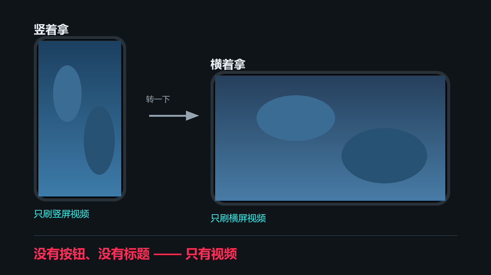
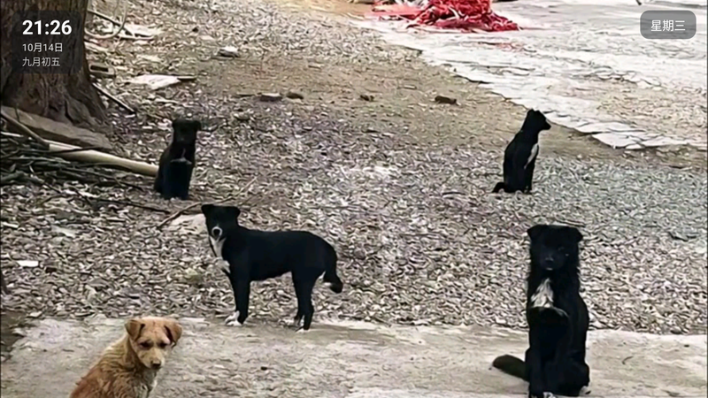

<div align="center">

# 老人抖抖

**给不识字的老人用的极简抖音 —— 开机就是视频，只会上下滑就够了。**

> ### ⚠️ 声明
>
> **视频内容的版权归抖音及其创作者所有。**
> 本软件仅供**个人学习研究**使用，**请在下载后 24 小时内删除**。
> 详见 [版权与使用声明](#版权与使用声明)。

<p align="center">
  
</p>

实际运行时的样子（那张图里的字幕是视频内容自带的，不是界面元素）：

<p align="center">
  
</p>

</div>

---

## 这是什么

一个**只保留"上下滑看视频"**的抖音客户端。

它把抖音里所有需要认字、需要找按钮、可能点错的东西全部删掉了 —— 界面上**没有任何按钮**，
画面上只有视频本身（只在顶部角落保留一小块时间/日期，见功能表）。给不识字的老人用时，只要教会一个动作：**往上滑**。

> 这个项目不是从零写的，它是把一个成熟的开源项目（[腕上音符](https://github.com/5h1iky/wanshang-yinfu)）
> 裁剪成"只剩上下滑"的产物。详见 [源码来源与致谢](#源码来源与致谢)。

---

## 功能

### 保留的

| 功能 | 说明 |
|---|---|
| **上下滑看视频** | 唯一的操作。滑一下就换下一条 |
| **竖屏刷竖屏、横屏刷横屏** | 竖着拿只刷竖屏视频；转成横屏自动换成横屏信息流，反过来也一样。当前视频不会因为转屏而重新加载 |
| **沉浸式全屏** | 没有状态栏、没有导航栏，画面占满整屏 |
| **预加载** | 提前缓存下一条，滑动几乎不用等 |
| **可设为桌面启动器** | 设为默认主屏后，开机直接进视频，老人不用在桌面找图标 |
| **看过的不再推** | 跨会话去重，不会翻来覆去都是那几条 |
| **屏幕常亮** | 看着看着不会黑屏 |
| **顶部信息栏** | 左上角：时间 + 公历日期 + 农历；右上角：星期 + 今日节日（当天没有节日时自动隐藏那一行） |

### 刻意去掉的

- **暂停 / 进度条 / 双击快进** —— 点屏幕什么都不发生（防止误触）
- **字幕、弹幕**
- **点赞、评论、收藏、分享、作者主页**
- **登录** —— 全程游客身份，不需要任何账号
- **设置页、搜索、关注、直播、频道、精选**
- **画面上的文字** —— 标题、作者名、头像、点赞数，一个都不留（唯一留下的，是顶部那一小块时间/农历/星期/节日）

---

## 怎么用

只有两个动作：

1. **上下滑** —— 换下一个视频
2. **转手机** —— 竖着拿刷竖屏视频，横着拿刷横屏视频

没有按钮要认，没有字要看。

---

## 安装

1. 到 [Releases](../../releases) 下载 `app-release.apk`
2. 传到手机上安装（系统可能会提示"未知来源"，允许即可）

**想让它开机直达**：系统设置 → 应用 → 默认应用 → 主屏幕应用 → 选「老人抖抖」。
之后开机就直接进视频流；要改回系统桌面，在同一个地方换回去即可。

---

## 系统要求

| 项目 | 要求 |
|---|---|
| **Android 版本** | **4.0（API 14）及以上** —— 一直覆盖到 2011 年的老机型；同时已适配到 Android 16（targetSdk 36） |
| **CPU 架构** | **任意** —— arm64-v8a / armeabi-v7a / x86 / x86_64 都能装、都能跑 |
| 存储空间 | 应用约 10 MB；视频缓存最多 128 MB（会自动淘汰旧的，也可以一键清空） |
| 网络 | 需要联网 |
| 权限 | **只要网络权限**（不读通讯录、不读相册、不申请定位） |

> **为什么 CPU 架构无所谓**：本应用**不含任何 native 库**（纯 Java 字节码），
> 由系统自带的 ART 运行时执行，与 CPU 是 arm 还是 x86 无关。
>
> **关于 Android 版本下限**：**14 是硬底线** —— 实测 13 会被 material 组件库直接拒绝。
> 从 21 一路降到 14 要额外做四件事：把 androidx 从 1.7 降到 1.6、OkHttp 从 4.x 降到 3.12、
> **手动开启 multidex**（Android 5.0 以下没有系统级 multidex），以及
> **给老系统补上 TLS 1.2**（API 20 之前默认不启用，而抖音的接口与视频 CDN 全在 HTTPS 上；
> 不补的话老设备表现为"一直转圈、拉不到视频"，且不会有任何报错）。

---

## 源码来源与致谢

**本项目不是从零写的。** 它建立在下面这些开源项目之上，原作者的工作是全部基础：

| 项目 | 用在哪 | 许可证 |
|---|---|---|
| [**腕上音符**](https://github.com/5h1iky/wanshang-yinfu) | **直接基座** —— 数据层、播放页、去重、预加载、签名封装都是从它裁剪而来 | **GPL-3.0** |
| [DKVideoPlayer](https://github.com/Doikki/DKVideoPlayer) | 播放内核（源码内嵌于 `lib/`，其 TikTok2 demo 是上下滑的原型） | Apache-2.0 |
| [VerticalViewPager](https://github.com/castorflex/VerticalViewPager) | 纵向翻页容器（`widget/VerticalViewPager.java`） | Apache-2.0 |
| [douyin_sign](https://github.com/ylcangel/douyin_sign) | `a_bogus` 签名的 JS 实现（`assets/sign/`，App 内用 Rhino 执行） | Apache-2.0 |
| [DouYin_Spider](https://github.com/cv-cat/DouYin_Spider) | 接口知识参考（未复制代码） | 无 |

### 相对基座「腕上音符」改了什么

**删掉的**
- 页面：主屏、登录、私信会话、聊天、评论、我的、作者主页、设置、关于
- 交互：点赞、收藏、评论、分享、作者主页入口、全屏开关、双指缩放、手动旋转、暂停、进度条、可见返回键
- 覆盖层：标题、作者名、头像、各项计数 —— **画面上不留任何文字**
- 其他：登录态注入、公告、更新检查、免责声明弹窗

**新增的**
- **横竖屏分流**：竖屏只刷竖屏视频，横屏只刷横屏视频（换流时当前视频保活，不重新加载）
- **沉浸式全屏**：`IMMERSIVE_STICKY`，顺带挡掉"横屏上滑 = 系统回主屏"的误触
- **桌面启动器身份**：`HOME` category，可被设为系统默认主屏
- **按方向过滤**：混进来的反向视频会被直接丢掉

---

## 许可证

**GPL-3.0** —— 继承自基座项目「腕上音符」。见 [LICENSE](LICENSE)。

你可以自由使用、修改、分发，但**衍生作品也必须以 GPL-3.0 开源**。

---

## 数据是怎么来的

视频内容取自抖音 Web 端（`www.douyin.com`）的公开接口，**全程游客身份**（不登录、不采集任何账号信息）：

- 信息流接口：`/aweme/v1/web/tab/feed/`
- 风控签名：`a_bogus` —— App 内用 Rhino 执行 `douyin_sign` 的 JS 实时计算
- 两套参数决定内容方向（实测结论）：
  - PC 参数（`aid=6383 + channel_pc_web + device_platform=webapp`）→ **93% 是横屏视频**
  - 移动端参数（`aid=1128 + channel_web_mobile + device_platform=android`）→ **75% 是竖屏视频**
- 播放地址必须带 `Referer: https://www.douyin.com/`，否则 CDN 一律 403

完整实测记录见 [docs/FEASIBILITY_PROBE.md](docs/FEASIBILITY_PROBE.md)，
可复现的探测脚本在 [probe/](probe/)（Node 环境，直接跑即可）。

---

## 自己编译

要求：**JDK 17+**（本项目用 21）、**Android SDK 36**。

```bash
./gradlew assembleDebug      # 调试包
./gradlew assembleRelease    # 发布包（需在根目录放 keystore.properties）
./gradlew testDebugUnitTest  # 单元测试
```

`keystore.properties`（不入库，缺失时 release 会退化为未签名）：

```properties
storeFile=my-upload-key.jks
storePassword=...
keyAlias=...
keyPassword=...
```

---

## 已知限制

- **依赖抖音的非公开接口**，抖音改版就可能失效（签名算法尤其）。失效时的表现通常是"列表空白"，而不是崩溃。
- 竖屏流是"以竖屏为主"（实测约 75%），并非 100% —— 混进来的横屏视频会被客户端过滤掉，所以偶尔会连续翻几页才出一条。
- 本项目为**个人学习研究**用途，请勿用于商业用途。

---

## 版权与使用声明

### 一、视频版权

**所有视频内容的版权归抖音（北京微播视界科技有限公司）及其创作者所有。**

- 本软件**不存储、不缓存、不分发、不修改**任何视频内容 —— 它只是一个播放器，
  以游客身份读取抖音公开接口返回的内容并在本地播放；
- 本软件**不提供任何内容存储服务**，也不绕过任何付费或权限机制；
- 应用运行过程中不保存、不转发任何视频文件。

### 二、使用限制

- 本软件**仅供个人学习研究使用**，请勿用于任何商业用途；
- **请在下载后 24 小时内删除本软件**；
- 本项目与抖音官方**没有任何关系**，不是官方应用，也未被官方授权或认可；
- 请遵守当地法律法规与平台服务条款，因使用本项目产生的一切后果由使用者自行承担。
