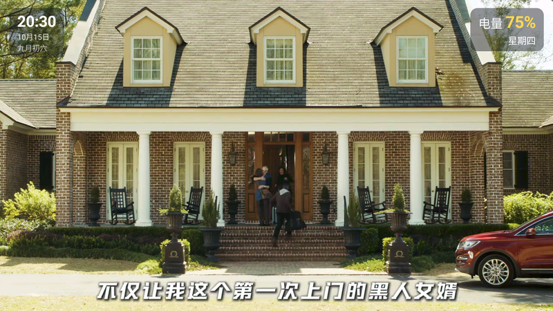

<div align="center">

# 适老短视频

**给不识字的老人用的极简抖音 —— 开机就是视频，只会上下滑就够了。**

> ### ⚠️ 声明
>
> **视频内容的版权归抖音及其创作者所有。**
> 本软件仅供**个人学习研究**使用，**请在下载后 24 小时内删除**。
> 详见 [版权与使用声明](#版权与使用声明)。

<p align="center">
  
</p>

实际运行时的样子 —— **竖着拿**刷竖屏视频、**横着拿**刷横屏视频。
画面上只有视频本身；左上角那块「时间 / 公历 / 农历」和右上角的星期，是**唯一保留**的界面元素
（画面里出现的文字都是抖音视频自带的，不是界面画的）：

<p align="center">
  
  &nbsp;&nbsp;&nbsp;
  
</p>

</div>

---

## 这是什么

一个**只保留"上下滑看视频"**的抖音客户端。

它把抖音里所有需要认字、需要找按钮、可能点错的东西全部删掉了 —— 界面上**没有任何按钮**，
画面上只有视频本身（只在顶部角落保留一小块时间/日期，见功能表）。给不识字的老人用时，只要教会一个动作：**往上滑**。

> 这个项目不是从零写的，它是把一个成熟的开源项目（[腕上音符](https://github.com/5h1iky/wanshang-yinfu)）
> 裁剪成"只剩上下滑"的产物。详见 [源码来源与致谢](#源码来源与致谢)。

---

## 功能

### 保留的

| 功能 | 说明 |
|---|---|
| **上下滑看视频** | 唯一的操作。滑一下就换下一条 |
| **竖屏刷竖屏、横屏刷横屏** | 竖着拿只刷竖屏视频；转成横屏自动换成横屏信息流，反过来也一样。当前视频不会因为转屏而重新加载 |
| **沉浸式全屏** | 没有状态栏、没有导航栏，画面占满整屏 |
| **预加载** | 提前缓存下一条；实测滑动切到下一条后 **0.1 秒**左右就出画面（新老机型都一样） |
| **可设为桌面启动器** | 设为默认主屏后，开机直接进视频，老人不用在桌面找图标 |
| **看过的不再推** | 跨会话去重，不会翻来覆去都是那几条 |
| **屏幕常亮** | 看着看着不会黑屏 |
| **顶部信息栏** | 左上角：时间 + 公历日期 + 农历；右上角：星期 + 今日节日（当天没有节日时自动隐藏那一行） |

### 刻意去掉的

- **暂停 / 进度条 / 双击快进** —— 点屏幕什么都不发生（防止误触）
- **字幕、弹幕**
- **点赞、评论、收藏、分享、作者主页**
- **登录** —— 全程游客身份，不需要任何账号
- **设置页、搜索、关注、直播、频道、精选**
- **画面上的文字** —— 标题、作者名、头像、点赞数，一个都不留（唯一留下的，是顶部那一小块时间/农历/星期/节日）

---

## 怎么用

只有两个动作：

1. **上下滑** —— 换下一个视频
2. **转手机** —— 竖着拿刷竖屏视频，横着拿刷横屏视频

没有按钮要认，没有字要看。

---

## 19 个版本（1 普通 + 1 老人专版 + 17 频道）

同一套代码一次构建出 **19 个 APK**，**包名各不相同，可以任意组合装在同一台手机上**、
各自独立升级：

| 版本 | 包名 | 内容 |
|---|---|---|
| **普通版** | `com.laorendouyin.app` | 抖音「推荐」流（原样） |
| **老人专版** | `com.laorendouyin.app.laoren` | **推荐流 + 三农 / 音乐 / 美食 / 动物 / 亲子 / 旅行 六个频道 + 相关视频 轮询混合** |
| **17 个频道版** | `com.laorendouyin.app.<频道>` | 各自只刷一个频道 |

**老人专版的频道**：三农（乡村生活/赶海/地方美食/非遗，画面导向）、音乐（经典老歌，
能只听不看）、美食（吃播直观）、动物（萌宠自然）、亲子（家庭日常）、旅行（各地风土人情）。

其中前四个是按**实测内容**挑的（各抓 20 条对比，见 `probe/probe_elder.js`），
后两个（亲子 / 旅行）是按**使用者的要求**加入的。
未选：体育（偏国际年轻赛事），以及知识/公开课/汽车/游戏/二次元/美妆/小剧场/生活vlog
（依赖文字或偏年轻人群）。

频道版的应用名会带后缀（「适老短视频·美食」「适老短视频·三农」…），装在一起一眼能分清。
**17 个频道全部实测有内容**（各返回 10 条）：

`全部` / `公开课` / `美食` / `游戏` / `二次元` / `体育` / `音乐` / `知识` /
`小剧场` / `影视` / `生活vlog` / `亲子` / `汽车` / `三农` / `动物` / `旅行` / `美妆穿搭`

内容**不是靠客户端筛选**，而是直接向抖音要那个频道（`/aweme/v1/web/channel/feed/`）。

**内容源是一个可配置的列表**（`app/build.gradle` 里各变体的 `CHANNEL_TAG_ID`，逗号分隔）。
每一项要么是频道 tag_id，要么是特殊值 —— `recommend`（推荐流）、`related`（相关视频）：

- `""` → 只有推荐流（普通版）
- `"300219"` → 只刷一个频道
- `"recommend,300219,300209,300204,300220,300217,300221,related"`
  → 推荐流 + 六个频道 + **相关视频** 轮询混合（老人专版，v1.19 起）

**「相关视频」是什么**：拿刚看过的那条视频的 `aweme_id` 当种子，向
`/aweme/v1/web/aweme/related/` 要同类内容。**游客态可用、每次 10~12 条、100% 带直链**，
是目前除频道流之外第二条能「定向内容」的通道（不需要登录）。

> ⚠️ 它返回的是**混合方向**（竖/横大致各半，用同方向种子也只是略好），所以只适合当
> 「内容不够时的补充」 —— 方向分流后一次大约剩 5~8 条可用；别指望它单独撑起一条流。
> 它还有一个「没有种子就用不了」的特点（App 刚启动时），代码里对此**不记失败、不进冷却**。
> 探测记录：[probe/probe_related.js](probe/probe_related.js)、
> [probe/probe_related_orientation.js](probe/probe_related_orientation.js)。

**所有版本都执行"方向分流"**（竖着拿只刷竖屏、横着拿只刷横屏）。

> ⚠️ **为什么不能按关键词做**（比如"上海话专版"）：实测**游客态下抖音不给** ——
> 搜索接口返回 `2483`「请先登录」、话题视频列表返回空 body、博主主页与视频详情
> `403`（缺 `Uifid`）、视频详情页被 JS 虚拟机保护；而推荐流里这类内容占比实测接近 0。
> 详见 [docs/FEASIBILITY_PROBE.md](docs/FEASIBILITY_PROBE.md)。

**增删频道**：在 `app/build.gradle` 的 `productFlavors` 里照抄一块（改 flavor 名 /
`CHANNEL_TAG_ID` / `CHANNEL_NAME`），再补一个
`app/src/<flavor 名>/res/values/strings.xml` 覆盖应用名即可。

---

## 安装

1. 到 [Releases](../../releases) 下载对应的 APK
   （普通版 `app-standard-release.apk` / 老人专版 `app-laoren-release.apk` /
   各频道 `app-<频道>-release.apk`）
2. 传到手机上安装（系统可能会提示"未知来源"，允许即可）

**想让它开机直达**：系统设置 → 应用 → 默认应用 → 主屏幕应用 → 选「适老短视频」。
之后开机就直接进视频流；要改回系统桌面，在同一个地方换回去即可。

---

## 播放内核与兜底链

播放这件事准备了**三条路**，目标是"任何一台机器上，至少有一个内核能把视频放出来"。

**但内核顺序是按系统版本分开的** —— 这不是理论推导，是**真机 tombstone 换来的**：

| 系统 | 顺序 | 为什么这样排 |
|---|---|---|
| **Android 5.0 以上** | **只用系统 MediaPlayer**（IJK 直接禁用） | IJK 在这类真机上**必崩**（见坑 1） |
| **Android 4.x** | **IJK** → ExoPlayer → 系统 MediaPlayer | 那边的系统解码器解不了 High Profile，IJK 是唯一活路（见坑 3） |

内核**只降不升**（进程内）：某个内核一旦失败就不再回头 —— 它能失败，就说明它对
这台机器/这条内容确实不行，切回去只会让用户再看一次同样的故障。

### 三个用真机踩出来的坑

**1. IJK 在真机上会 native 崩溃 —— 所以新系统干脆不用它。**

真机（Redmi / Android 15 / arm64）上反复闪退，抓到的 tombstone 指向同一处：

```
Cmdline: com.laorendouyin.app.laoren
tid 3418, name: ff_read                     ← IJK 的读线程
signal 7 (SIGBUS) / 11 (SIGSEGV)，PC 跳到垃圾地址
#01  libijkffmpeg.so (av_application_on_http_event+24)
```

这是 **IJK 自己的 bug**：它的 `ijkavapplication` 模块处理 **HTTP 事件回调**时
访问了失效指针。而**我们的用法必然触发它** —— IJK 的 FFmpeg 没编译 `https`（见坑 2），
所以每次播放都要绕道本地代理（`http://127.0.0.1:port/https%3A%2F%2F…`），
于是**每一次 HTTP 事件都会回调进那个坏函数**。

修法就是**新系统不再使用 IJK**：抖音的流都是标准 MP4 / H.264-HEVC，系统 MediaPlayer
完全够用（真机还有完整硬件解码），没理由为了 IJK 的容器兼容性去冒 native 崩溃的风险。
**老系统不能跟着禁** —— 那边 IJK 是唯一活路。

**2. IJK 自带的 FFmpeg 没有编译 `https` 协议。**

它的原生日志会明确报：

```
https protocol not found, recompile FFmpeg with openssl, gnutls or securetransport enabled.
```

然后以错误码 `-10000` 失败。所以**不能把抖音的 https 直连地址交给 IJK** ——
得走本机的缓存代理（`http://127.0.0.1:…`，由
[AndroidVideoCache](https://github.com/danikula/AndroidVideoCache) 提供）。
这条在 **Android 5.0 以下（也就是还在用 IJK 的地方）是强制的**。

**3. 老设备的解码器认不出高等级的 H.264。**

抖音给的 1080p 是 **High Profile @ Level 5.0**（`avc1.640032`），老机器（包括
Android 4.4 模拟器里那个纯软件解码器）直接报 `NoSupport`。所以**老系统上会主动把
清晰度降到 540p**（H.264 High@L3.1 才稳），这一档实测能正常解码播放。

> 📌 **内核顺序是按"实测成功率"排的，不是按理论优劣排的。** 两个反例都很有代表性：
> 老系统上 ExoPlayer 优先时，4.4 首条要**白等 11 秒**才失败（换成 IJK 后首条起播
> **11.5 秒 → 0.25 秒**）；而新系统上 IJK 优先时，真机**必崩**。

> ⚠️ 因为引入了 IJK 的 native 库，APK **不再是纯 Java**，
> 打包了 4 个 ABI：`arm64-v8a` / `armeabi-v7a`（Android 4 必需这个）/ `x86` / `x86_64`。

## 系统要求

| 项目 | 要求 |
|---|---|
| **Android 版本** | **4.0（API 14）及以上** —— 一直覆盖到 2011 年的老机型；同时已适配到 Android 16（targetSdk 36） |
| **CPU 架构** | **任意** —— arm64-v8a / armeabi-v7a / x86 / x86_64 都能装、都能跑 |
| 存储空间 | 应用约 10 MB；视频缓存最多 128 MB（会自动淘汰旧的，也可以一键清空） |
| 网络 | 需要联网 |
| 权限 | **只要网络权限**（不读通讯录、不读相册、不申请定位） |

> **关于 CPU 架构**：应用里带了 IJK 的 native 库，所以**打包了 4 个 ABI**
> （`arm64-v8a` / `armeabi-v7a` / `x86` / `x86_64`），覆盖从 2011 年的 32 位老机到现在的 64 位机型。
> 万一某个架构的 so 加载失败，会自动退到链路上的下一个内核（见上一节），不会因此打不开。
>
> **关于老系统**：Android 5.0 以下会额外做三件事 —— 装 **Conscrypt** 换掉系统的老 TLS、
> 自带一份新的 CA 证书列表（老系统内置的根证书是出厂那年的，认不出现在的证书链），
> 并且**播放一律走本机缓存代理**（原因见上一节的坑 1）。
>
> **关于 Android 版本下限**：**14 是硬底线** —— 实测 13 会被 material 组件库直接拒绝。
> 从 21 一路降到 14 要额外做四件事：把 androidx 从 1.7 降到 1.6、OkHttp 从 4.x 降到 3.12、
> **手动开启 multidex**（Android 5.0 以下没有系统级 multidex），以及
> **给老系统补上 TLS 1.2**（API 20 之前默认不启用，而抖音的接口与视频 CDN 全在 HTTPS 上；
> 不补的话老设备表现为"一直转圈、拉不到视频"，且不会有任何报错）。

---

## 源码来源与致谢

**本项目不是从零写的。** 它建立在下面这些开源项目之上，原作者的工作是全部基础：

| 项目 | 用在哪 | 许可证 |
|---|---|---|
| [**腕上音符**](https://github.com/5h1iky/wanshang-yinfu) | **直接基座** —— 数据层、播放页、去重、预加载、签名封装都是从它裁剪而来 | **GPL-3.0** |
| [DKVideoPlayer](https://github.com/Doikki/DKVideoPlayer) | 播放内核（源码内嵌于 `lib/`，其 TikTok2 demo 是上下滑的原型） | Apache-2.0 |
| [VerticalViewPager](https://github.com/castorflex/VerticalViewPager) | 纵向翻页容器（`widget/VerticalViewPager.java`） | Apache-2.0 |
| [douyin_sign](https://github.com/ylcangel/douyin_sign) | `a_bogus` 签名的 JS 实现（`assets/sign/`，App 内用 Rhino 执行） | Apache-2.0 |
| [DouYin_Spider](https://github.com/cv-cat/DouYin_Spider) | 接口知识参考（未复制代码） | 无 |

### 相对基座「腕上音符」改了什么

**删掉的**
- 页面：主屏、登录、私信会话、聊天、评论、我的、作者主页、设置、关于
- 交互：点赞、收藏、评论、分享、作者主页入口、全屏开关、双指缩放、手动旋转、暂停、进度条、可见返回键
- 覆盖层：标题、作者名、头像、各项计数 —— **画面上不留任何文字**
- 其他：登录态注入、公告、更新检查、免责声明弹窗

**新增的**
- **横竖屏分流**：竖屏只刷竖屏视频，横屏只刷横屏视频（换流时当前视频保活，不重新加载）
- **沉浸式全屏**：`IMMERSIVE_STICKY`，顺带挡掉"横屏上滑 = 系统回主屏"的误触
- **桌面启动器身份**：`HOME` category，可被设为系统默认主屏
- **按方向过滤**：混进来的反向视频会被直接丢掉

---

## 许可证

**GPL-3.0** —— 继承自基座项目「腕上音符」。见 [LICENSE](LICENSE)。

你可以自由使用、修改、分发，但**衍生作品也必须以 GPL-3.0 开源**。

---

## 数据是怎么来的

视频内容取自抖音 Web 端（`www.douyin.com`）的公开接口，**全程游客身份**（不登录、不采集任何账号信息）：

- 信息流接口（三种，按内容源轮询）：
  - 推荐流：`/aweme/v1/web/tab/feed/`
  - 频道流：`/aweme/v1/web/channel/feed/`（带 `tag_id`，17 个固定频道）
  - 相关视频：`/aweme/v1/web/aweme/related/`（带 `aweme_id` 种子，用于老人专版）
- 风控签名：`a_bogus` —— App 内用 Rhino 执行 `douyin_sign` 的 JS 实时计算
- 两套参数决定内容方向（实测结论）：
  - PC 参数（`aid=6383 + channel_pc_web + device_platform=webapp`）→ **93% 是横屏视频**
  - 移动端参数（`aid=1128 + channel_web_mobile + device_platform=android`）→ **75% 是竖屏视频**
- 播放地址必须带 `Referer: https://www.douyin.com/`，否则 CDN 一律 403

完整实测记录见 [docs/FEASIBILITY_PROBE.md](docs/FEASIBILITY_PROBE.md)，
可复现的探测脚本在 [probe/](probe/)（Node 环境，直接跑即可）。

---

## 自己编译

要求：**JDK 17+**（本项目用 21）、**Android SDK 36**。

> ⚠️ 仓库里**没有** `gradlew`（wrapper 未入库），请用本机安装的 Gradle 8/9。

```bash
gradle :app:assembleRelease            # 一次出全部 19 个包（推荐；堆已设 4G）
gradle :app:assembleStandardRelease    # 只出普通版
gradle :app:assembleSannongRelease     # 只出某个频道（flavor 名见 build.gradle）
gradle :app:assembleDebug              # 调试包
gradle :app:testDebugUnitTest          # 单元测试
```

产物按变体分目录：`app/build/outputs/apk/<flavor>/release/app-<flavor>-release.apk`。

> 关于 lint：`lintVital*` 实测会长时间挂起且与出包无关，已在 `build.gradle` 里
> 用 `lint { checkReleaseBuilds = false }` 关掉 —— 有了 flavor 之后，命令行上也没法
> 再用单个 `-x lintVitalRelease` 规避（那要写全 18 个任务名）。

`keystore.properties`（不入库，缺失时 release 会退化为未签名）：

```properties
storeFile=my-upload-key.jks
storePassword=...
keyAlias=...
keyPassword=...
```

---

## 已知限制

- **依赖抖音的非公开接口**，抖音改版就可能失效（签名算法尤其）。失效时的表现通常是"列表空白"，而不是崩溃。
- 竖屏流是"以竖屏为主"（实测约 75%），并非 100% —— 混进来的横屏视频会被客户端过滤掉，所以偶尔会连续翻几页才出一条。
- **Android 4.4 及更老的机器走软件解码** —— 老设备的硬件解码器普遍认不出抖音的 H.264
  High Profile，所以那条路上会主动降到 540p 并用 FFmpeg 软解。实测能流畅播放
  （没有掉帧），但更吃 CPU、也更费电。
- 本项目为**个人学习研究**用途，请勿用于商业用途。

---

## 版权与使用声明

### 一、视频版权

**所有视频内容的版权归抖音（北京微播视界科技有限公司）及其创作者所有。**

- 本软件**不分发、不修改**任何视频内容 —— 它只是一个播放器，
  以游客身份读取抖音公开接口返回的内容并在本地播放；
- 为保证播放流畅，应用会在**应用私有目录**内暂存视频片段（预加载与缓存，上限 128MB），
  **退出应用时自动清空**；本软件**不提供**保存、下载、导出或分享视频的功能；
- 本软件**不提供任何内容存储服务**，也不绕过任何付费或权限机制。

### 二、使用限制

- 本软件**仅供个人学习研究使用**，请勿用于任何商业用途；
- **请在下载后 24 小时内删除本软件**；
- 本项目与抖音官方**没有任何关系**，不是官方应用，也未被官方授权或认可；
- 请遵守当地法律法规与平台服务条款，因使用本项目产生的一切后果由使用者自行承担。
